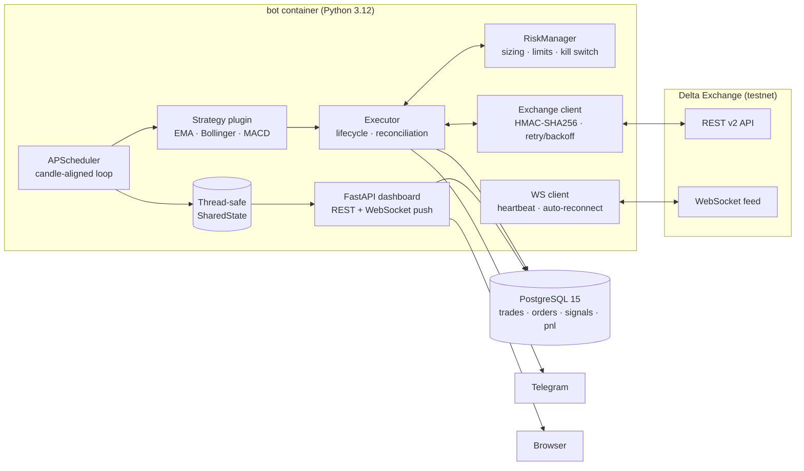

<div align="center">

# Delta Futures Trading Bot

**A self-healing, risk-first trading system for BTCUSD perpetual futures**

*It assumes things will break, and is built to recover when they do.*


</div>

---

## TL;DR

A complete automated trading system, from market data to order execution to monitoring, running 24/7 in Docker against **Delta Exchange India's testnet** (simulated funds, real market data).

| | |
|---|---|
| **What it does** | Trades BTCUSD perpetual futures on candle-close signals from one of 3 pluggable strategies. Every trade gets an exchange-side stop-loss and take-profit. |
| **What makes it different** | A **reconciliation engine** checks the bot's own records against the exchange's real state at every candle close and repairs any mismatch. Crashes, restarts and manual changes don't leave it unprotected. |
| **How you watch it** | A live web dashboard (TradingView candles, equity curve, Sharpe/drawdown, streaming logs, kill switch) plus a Telegram alert for every trade event. |
| **Size** | ~5,100 lines of Python + a 1,300-line single-page dashboard, 4-table PostgreSQL schema with Alembic migrations, one-command Docker deploy. |

---

## The problem I set out to solve

Writing a trading *strategy* is the easy part. A crossover rule is about 10 lines of pandas. What actually loses money in automated trading is everything **around** the strategy:

- The bot crashes **after** the entry order fills but **before** the stop-loss is placed, leaving an open, leveraged position with no protection.
- A stop-loss fires, but the matching take-profit is never cancelled. Later it fills on its own and opens a brand-new position in the opposite direction.
- The process restarts and has no memory of which orders on the exchange belong to it.
- An API call times out. Did the order go through or not?
- A bad day turns into a disaster because nothing stops the bot from trading through it.

Most hobby trading bots are a strategy wrapped in a `while True` loop, and they are one network glitch away from an unmanaged position. **I wanted a bot whose default state is "safe", whatever happened before.** That one requirement drove most of the architecture.

---

## What makes it special

### 1. Self-healing reconciliation: the exchange is the source of truth

At every candle close, before it even looks at a new signal, the bot runs a full reconciliation pass:

```
 ┌─────────────── every candle close (+5s) ───────────────┐
 │                                                         │
 │  1. Kill-switch & daily-loss check   → halt if tripped  │
 │  2. Reconcile positions vs. orders   → repair if wrong  │──┐
 │  3. Poll pending entries             → fill or expire   │  │ if anything was
 │  4. Poll SL/TP orders                → book PnL, cancel │  │ repaired, skip
 │     the counterpart                                     │  │ new signals this
 │  5. Clean up orphaned & stale orders                    │  │ candle: act only
 │  6. Evaluate strategy                ← only if healthy  │◀─┘ on a known-good
 │  7. Risk-check, size, place order                       │    state
 │  8. Publish state to dashboard (always, in `finally`)   │
 └─────────────────────────────────────────────────────────┘
```

The rule it enforces: **each open position has exactly one stop-loss and exactly one take-profit, each matching the position size.** If that isn't true (duplicate orders, a missing stop, a wrong size, or "ghost" orders from a crash mid-placement), the bot cancels *every* exit order on the exchange, including ones its database never recorded, and places a fresh, correct pair. If there's no position but orders are still open, they're cancelled.

This makes the bot **crash-tolerant without a separate recovery mode**. Restarting it, killing the container mid-trade, or changing something by hand on the exchange UI all end the same way: the next tick brings it back to a correct state.

### 2. Order handling built for real fills

- **Limit entries at the mid-price**, not market orders, to control slippage. A 0.5% **spread filter** blocks entries when the order book is thin.
- **Entries that don't fill expire** after a set number of candles (default 3) and are cancelled, so they don't fill hours later at a stale price.
- **Stop-limit exits with `reduce_only`**, so an exit order can never accidentally open or flip a position.
- **Counterpart cancellation in one lookup:** each trade row stores its SL and TP exchange order IDs, so when one fills the other is cancelled at once. There's a backup too: a targeted cancel first, then `cancel_all_orders` if that fails.
- **Retries that know what's safe to retry:** exponential backoff on timeouts, 429s and 5xx errors, but **never on 4xx**, because resending a rejected order is how you get duplicate fills.

### 3. Layered risk management

| Layer | Rule | Why |
|---|---|---|
| Position sizing | Fixed-fractional: 2% of capital × leverage ÷ price | Position size grows and shrinks with the account |
| Per-trade exit | 1.5% stop-loss / 3% take-profit (2:1 reward-to-risk) | Breaks even at a ~34% win rate |
| Exposure cap | Max 2 concurrent positions (counted from the DB, not memory) | Survives restarts |
| Daily circuit breaker | Halt new entries at −5% daily PnL, auto-reset at 00:00 UTC; PnL reloaded from DB on startup | A restart can't reset the loss counter |
| Kill switch | Dashboard button, env var, or startup check → cancel all, flatten all, mark trades `killed` | One action to stop everything |
| Graceful shutdown | SIGTERM/SIGINT → cancel orders → close positions → record → alert | Never leaves orders unattended |

### 4. Strategies are plugins, not rewrites

Strategies implement a small abstract interface (`evaluate`, `get_required_candle_count`, `get_name`) and are selected at runtime from a registry with one env var:

| Strategy | Market behaviour it targets | Signal |
|---|---|---|
| `ema_crossover_rsi` | Trend | EMA-9/21 crossover, filtered by RSI band (avoids chasing overextended moves) |
| `bollinger_mean_revert` | Range / reversion | Close outside a 2σ band + RSI < 30 / > 70 |
| `macd_momentum` | Momentum | MACD/signal crossover confirmed by histogram sign |

All signals use the **last closed candle** (`iloc[-2]`), never the still-forming one, which prevents the classic "repainting" lookahead bug. The execution, risk and persistence layers don't change when you switch strategies.

### 5. Everything is observable

- **Live dashboard** (FastAPI + WebSockets, no frontend framework): TradingView candlestick chart with EMA overlays, entry markers and SL/TP lines; cumulative PnL curve; win rate, profit factor, Sharpe ratio and max drawdown; open positions with live unrealized PnL; a streaming, filterable log console; a confirm-protected kill switch.
- **Telegram alerts** for 12 lifecycle events: signal, order placed, filled, cancelled, SL hit, TP hit, daily limit, kill switch, errors, start/stop, and a PnL summary every 6 hours.
- **Full audit trail in PostgreSQL**: every signal (with indicator values), every order, every trade state change (`pending → open → closed / failed / killed`), and periodic PnL snapshots. The schema is versioned with Alembic.

---

## Architecture



**Design choices that were deliberate:**

- **Synchronous core, async edges.** The trading path is single-threaded and synchronous, so the order of every exchange action is easy to reason about and there are no races between "check position" and "place order". Async is used only where it pays off: the dashboard and the market-data WebSocket.
- **No CCXT.** I wrote a direct REST client with HMAC-SHA256 signing to get full control over Delta-specific behaviour (contract-unit conversion, side derived from signed position size, stop-order types). It still returns CCXT-shaped dicts, so it stays portable.
- **Fail-fast config.** All settings live in one frozen dataclass loaded from the environment. Missing credentials stop the process at startup, not mid-trade.
- **Candle-aligned scheduling.** Cron triggers fire at the candle boundary + 5s (e.g. `:00:05`, `:15:05`, …), so decisions are always made on fully closed candles.

---

## Tech stack

| Layer | Technology |
|---|---|
| Language | Python 3.12 |
| Data & indicators | pandas, pandas-ta |
| Exchange I/O | `requests` (REST, HMAC-SHA256), `websockets` (streaming) |
| Scheduling | APScheduler (cron, candle-aligned) |
| Persistence | PostgreSQL 15, SQLAlchemy 2.x ORM, Alembic migrations |
| Dashboard | FastAPI, Uvicorn, WebSockets, TradingView Lightweight Charts, Chart.js |
| Alerts | Telegram Bot API |
| Deployment | Docker, Docker Compose (bot + healthchecked Postgres), Makefile |

---

## Quick start

**Prerequisites:** Docker Desktop, Git, a free [Delta Exchange India testnet](https://demo.delta.exchange) API key, and a Telegram bot token from [@BotFather](https://t.me/BotFather).

```bash
git clone https://github.com/SaileshKumarT/Trading-bot.git
cd Trading-bot
cp .env.example .env        # fill in API keys, Telegram token, DB password
make build && make up       # bot + PostgreSQL
make migrate                # apply Alembic migrations
make dashboard              # open http://localhost:8080
```

Switch strategies by setting `ACTIVE_STRATEGY` in `.env` (`ema_crossover_rsi` · `bollinger_mean_revert` · `macd_momentum`) and running `make down && make up`.

| Command | What it does |
|---|---|
| `make logs` | Tail live bot logs |
| `make shell` | Shell into the bot container |
| `make down` | Graceful stop (cancels orders, closes positions, sends alert) |

<details>
<summary><b>Key configuration</b> (all settings are in <code>.env.example</code>)</summary>

| Variable | Default | Purpose |
|---|---|---|
| `TRADING_SYMBOL` | `BTCUSD` | Perpetual contract to trade |
| `TIMEFRAME` | `15m` | Candle interval |
| `CAPITAL` | `10000` | Capital base for sizing (USDT) |
| `RISK_PER_TRADE` | `0.02` | Fraction of capital per trade |
| `LEVERAGE` | `5` | Leverage multiplier |
| `STOP_LOSS_PCT` / `TAKE_PROFIT_PCT` | `0.015` / `0.03` | Exit distances |
| `MAX_OPEN_POSITIONS` | `2` | Concurrent position cap |
| `DAILY_LOSS_LIMIT` | `0.05` | Daily circuit breaker (fraction of capital) |
| `ORDER_EXPIRY_CANDLES` | `3` | Cancel unfilled entries after N candles |
| `SPREAD_MAX_PCT` | `0.005` | Skip entries when the spread is wider than this |
| `KILL_SWITCH` | `false` | Emergency stop, checked every loop |

Strategy-specific parameters (`EMA_*`, `RSI_*`, `BB_*`, `MACD_*`) are documented in `.env.example` and in [PROJECT_AUDIT.md](PROJECT_AUDIT.md#13-configuration-reference).

</details>

---

## Project structure

```
bot/
├── main.py              # Entry point, candle-aligned scheduler, strategy loop, graceful shutdown
├── executor.py          # Trade lifecycle + reconciliation engine (largest module)
├── exchange.py          # Delta REST client: signing, retries, symbol & contract conversion
├── risk.py              # Sizing, SL/TP, position cap, daily circuit breaker, kill switch
├── pnl.py               # Trade PnL and 6-hourly performance summaries
├── ws_client.py         # Authenticated WebSocket feed with heartbeat + backoff reconnect
├── database.py          # SQLAlchemy models: trades, orders, signals, pnl_summary
├── telegram_alerts.py   # 12 lifecycle alerts
├── config.py            # Frozen, fail-fast config dataclass
├── strategies/          # BaseStrategy ABC, registry, 3 strategy plugins
└── dashboard/           # FastAPI server, WebSocket manager, thread-safe state, SPA frontend
alembic/                 # Versioned schema migrations
```

A full module-by-module breakdown is in **[PROJECT_AUDIT.md](PROJECT_AUDIT.md)**.

---

## How I built it

I built this with AI pair-programming. That made me fast at producing code, so I spent most of my own effort on what AI doesn't decide for you: **what the system must guarantee, and how it can fail.** The failure modes above (a crash between fill and stop placement, SL and TP both filling, restart amnesia, a duplicated retried order) shaped the reconciliation loop and the risk layers, and I ran the system against the live testnet to watch how it behaved.

When it was working, I ran a **full self-audit** ([PROJECT_AUDIT.md](PROJECT_AUDIT.md)), reading the codebase as a reviewer would and listing its weaknesses as plainly as its strengths. Being able to explain, defend and critique every part of a system matters more to me than having written every line by hand.

---

## Known limitations & roadmap

I'd rather list these myself than have a reviewer find them:

| Limitation | Planned fix |
|---|---|
| No backtesting; strategies are validated live on testnet only | Event-driven backtester that reuses the same `BaseStrategy` interface, with walk-forward evaluation |
| Static % stops | ATR-based and trailing stops |
| Dashboard prices refresh at candle close; the WS feed isn't wired into it yet | Bridge `MarketState` → `SharedState` behind a lock for tick-level updates |
| Dashboard and kill switch have no authentication | Token auth + bind to localhost by default |
| Bollinger/MACD read env vars directly and reuse EMA-named signal fields | Move into the central config; give `StrategySignal` a typed indicator payload |
| No automated test suite | Unit tests for sizing/PnL/signals; exchange-mocked tests for reconciliation edge cases |
| Account-level drawdown tracking is daily only | High-water-mark equity curve with max-drawdown circuit breaker |

---

## Disclaimer

This project trades on the **Delta Exchange India testnet** with simulated funds, for learning and demonstration. It is not financial advice. Running it against a live account is entirely at your own risk.
